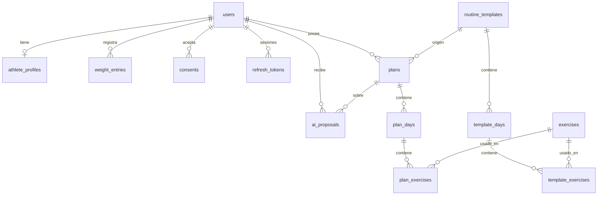

# Arquitectura del backend

Documento para entender **cómo viaja una petición** y **qué guarda cada tabla**, sin necesidad de leer todo el código.

## 1. Recorrido de una petición (ejemplo: "agregar un ejercicio al día")

1. El navegador envía `POST /v1/plans/active/days/{dia}/exercises` con un JSON `{ "exerciseId": "..." }` y el token de sesión.
2. **`main.py`** aplica CORS (¿este sitio puede llamar a la API?) y el límite de solicitudes por minuto.
3. **`deps.py`** (`current_user`) lee el token, comprueba que es válido y carga al usuario. Si no, responde `401`.
4. **`schemas.py`** (`AddExerciseIn`) valida el JSON. Si falta algo o está fuera de rango, responde `422` sin tocar la base de datos.
5. **`routers/plans.py`** (controlador) comprueba que el día pertenece al plan activo **de ese usuario** (si no, `404`), que el ejercicio existe y que no está repetido.
6. **`services/planner.py`** calcula series, repeticiones, descanso y carga del ejercicio nuevo.
7. **`models.py`** guarda los cambios en la base de datos.
8. El controlador responde con el día actualizado (`EditResult`) y las advertencias, si las hay.

Regla práctica para ubicar un cambio: *¿cambia una pantalla?* → frontend. *¿Cambia un dato recibido o devuelto?* → `schemas.py`. *¿Cambia una regla (cuántas series, qué carga)?* → `services/`. *¿Cambia qué se guarda?* → `models.py`. *¿Cambia quién puede hacer qué?* → `routers/` y `deps.py`.

## 2. Tablas (13)

| Tabla | Qué guarda |
|-------|-----------|
| `users` | Cuenta: correo, hash de contraseña (nunca la contraseña), rol, intentos fallidos |
| `consents` | Qué aceptó cada usuario y cuándo (mayoría de edad, términos, aviso de que no es asesoría médica) |
| `refresh_tokens` | Sesiones renovables (se guarda solo un hash, y cada uso se rota) |
| `athlete_profiles` | Datos base y parámetros de entrenamiento (1 por usuario) |
| `weight_entries` | Historial de peso: cada cambio de peso deja un registro |
| `exercises` | Catálogo con ficha técnica, patrón de movimiento, ratio de carga y GIF/video opcional |
| `routine_templates` · `template_days` · `template_exercises` | Las **45 plantillas maestras**: la "receta" original que no cambia |
| `plans` · `plan_days` · `plan_exercises` | La **copia personal** del usuario: aquí se edita sin tocar la plantilla |
| `ai_proposals` | Propuestas de la IA, su estado y los tokens consumidos |

**Idea clave:** al generar el plan se *copia* la plantilla al usuario. Por eso puede editar libremente y, cuando quiera, "volver al plan recomendado" (se vuelve a copiar desde la plantilla). Los planes viejos no se borran: pasan a `ARCHIVED`.

## 3. Seguridad en pocas líneas

- Contraseñas: hash `scrypt` con sal; nunca se guardan en texto plano.
- Sesión: token de acceso (15 min) + token de renovación (30 días, de un solo uso).
- 5 contraseñas incorrectas seguidas bloquean el acceso 15 minutos; el mensaje es el mismo exista o no el correo.
- Cada consulta a planes y propuestas comprueba que el dato **pertenece al usuario** que pregunta.
- Los textos que muestra el frontend se insertan como texto, no como HTML (evita XSS).
- El token de la IA solo existe en el servidor.

## 4. Glosario

| Término | Significado |
|---------|-------------|
| **API / endpoint** | Dirección del backend a la que el frontend le pide o le envía datos |
| **JSON** | Formato de texto con el que se intercambian los datos |
| **JWT / token** | "Pase" firmado que prueba quién eres sin volver a pedir la contraseña |
| **CORS** | Regla del navegador: solo deja que una web llame a una API si la API lo autoriza |
| **ORM (SQLAlchemy)** | Permite manejar tablas como clases de Python |
| **Migración** | Script versionado que modifica tablas ya creadas sin perder datos (pendiente, ver registro) |
| **Plantilla maestra** | Rutina base guardada en la BD; el motor la elige por filtros |
| **Compuesto / aislamiento** | Ejercicio de varias articulaciones (sentadilla) / de una sola (curl de bíceps) |
| **Token (IA)** | Fragmento de texto que el proveedor de IA cuenta para cobrar |
| **Variable de entorno** | Valor de configuración que vive fuera del código (claves, URLs) |
